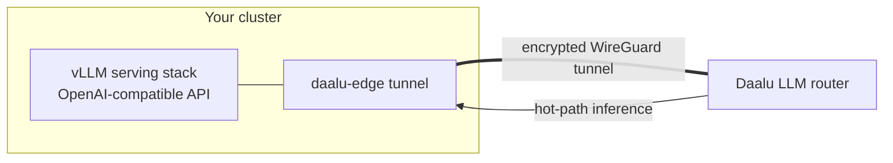

# 35. Connecting your own GPU — end-to-end

This chapter takes you from "I have a Kubernetes cluster with an NVIDIA
GPU in it" to "Daalu's AI runs on my hardware." It is shorter than it used
to be, because the onboarding is now **zero-touch**: once your cluster is
connected, adding a GPU is a single form in the UI. Daalu discovers the
card, deploys the serving stack, wires the routing, and shows you the
deploy as it happens.

Chapter 15 covers *why* local inference (cost, privacy, latency) and what
the router does with it. This chapter is the *how*.

---

## What you'll end up with

Daalu deploys an **open vLLM stack** (Apache-2.0 serving engine, open
model weights — Llama 3.1 8B Instruct by default) onto your GPU node and
routes your tenant's hot-path inference — alert triage, classification,
briefings — through the tunnel to it. Prompts stay on your network; your
per-call inference cost drops to the electricity.

---

## Hardware quick guide

| GPU | VRAM | Good for |
|---|---|---|
| 16 GB class (e.g. RTX 2000 Ada) | 16 GB | The 8B default model — the everyday starter card |
| 24 GB class (e.g. RTX 4090) | 24 GB | 8B with more headroom; best price/throughput |
| 48 GB class (e.g. RTX 6000 Ada, A40) | 48 GB | Larger models, including the ~30B coding models the Workspace uses |
| 80 GB class (A100/H100) | 80 GB | 70B-class models, heavy concurrency |

One card is enough to start. You can connect more than one — each shows
up individually on the AI Factory page (chapter 50).

---

## Prerequisites

Three things must be true before the form will succeed. All are one-time,
cluster-level setup:

1. **A Kubernetes cluster with the GPU node in it**, running the
   **NVIDIA GPU Operator** (the standard way to expose NVIDIA GPUs to
   Kubernetes — it installs the device plugin, GPU discovery, and the
   DCGM telemetry exporter). Your platform team likely has this already
   if the cluster runs any GPU workload.
2. **The cluster is connected to Daalu** via `daalu-edge` (chapter 34).
   The install snippet the cluster-onboarding wizard generates already
   includes everything the GPU path needs — the inference and telemetry
   proxies are pre-wired, and the edge registers the cluster credential
   with Daalu by itself. There is no extra manifest and no kubeconfig to
   paste.
3. **A Hugging Face token, if your model is gated.** The default Llama
   weights require accepting Meta's licence on Hugging Face and supplying
   a read token once. Ungated models (e.g. Qwen) need none.

That's it. In particular, you do **not** need to:

- hand-label the GPU node — Daalu derives the GPU class automatically
  from what GPU discovery reports about the card;
- mint credentials or assemble a kubeconfig — the edge self-registers,
  and a rebuilt cluster replaces its own stale credential automatically;
- run any follow-up `helm upgrade` — the initial install is complete.

---

## Connecting the GPU

1. Open **Usage & Pricing** in the sidebar and find the **Local GPU**
   card. Click **Connect your GPU**.
2. **Cluster** — pick the connected cluster the GPU lives in. The form
   immediately shows the **detected GPUs** on that cluster: node name,
   the derived GPU class, and how many GPUs the node exposes. Click a
   detected node to select its class — you don't need to know your node
   labels.
3. **vLLM endpoint URL** — pre-filled from the cluster you picked; leave
   it alone unless you're pointing Daalu at a vLLM you already run
   yourself.
4. **HF token** — paste your Hugging Face read token (only needed for
   gated models, and only on first deploy — weights are cached on the
   node afterwards).
5. **Served model** — the default `meta/llama-3.1-8b-instruct` is right
   for a 16 GB card. Larger cards can serve larger models.
6. Click **Deploy & connect.**

The request is accepted **immediately** — the deploy itself runs in the
background on your cluster, and the card flips to **Deploying…**. You can
leave the page; the status keeps updating.

### Watching it come up — the Deploy progress panel

A first vLLM boot is three sequential multi-minute waits that look
identical from the outside: pulling a ~10 GB serving image, pulling ~5 GB
of model weights, then compiling GPU kernels. The **Deploy progress**
panel on the Local GPU card makes each visible. Expand it to see:

- the pod, its phase, and each container's state — including the *reason*
  when something is blocked (`ImagePullBackOff`, `CrashLoopBackOff`, …),
- the cluster events that explain a stall (the only signal that exists
  before a container has started),
- the vLLM logs, streamed in once the server process is up.

The panel polls only while it's open (each poll reaches through the
tunnel into your cluster). When the stack answers its health check, the
pill flips to **Online** and the router starts using it.

> **A still-booting GPU is safe.** The router registers your endpoint up
> front and simply falls through to the next tier until it answers — a
> booting GPU behaves like a momentarily-offline one, never like an
> error in your face.

---

## Verifying it's really yours

- **Usage & Pricing** — the Local GPU pill reads **Online**, with the
  endpoint and model beside it.
- **AI Factory** (chapter 50) — the card appears with live utilisation
  and thermals once the cluster's Prometheus is connected.
- **Usage** — inference usage rows start landing in the local tier as
  the router sends traffic there (chapter 22).

Trigger something — regenerate the home-page briefing, or ask the
Assistant to triage an alert — and watch the utilisation move.

---

## More than one GPU

Connect additional cards the same way. Each physical GPU gets its own
card on the AI Factory page (cards are identified by the GPU's hardware
UUID, so two identical cards on different nodes never collapse into one
row). Different cards can serve different models — a 16 GB card for the
classifier tier and a 48 GB card for the coding model is a common
split — and the Workspace's model picker (chapter 26) reflects what is
actually serving.

---

## Disconnecting

**Usage & Pricing → Local GPU → Disconnect** removes the endpoint from
the router. Your tenant falls back to the next configured tier (chapter
36); nothing else changes. The serving stack in your cluster is torn down
by the same controller that deployed it.

---

## Troubleshooting

**The card says Deploying… for a long time.** Expand **Deploy progress**.
The first boot's image + weight pulls genuinely take several minutes on
an ordinary uplink; as long as the events show pulls progressing, it's
working.

**`ImagePullBackOff` / `ErrImagePull` in the progress panel.** The node
can't fetch the serving image — check the cluster's egress and registry
access.

**Pod `Pending` with `Insufficient nvidia.com/gpu`.** Kubernetes isn't
advertising the GPU — the GPU Operator on the cluster isn't healthy on
that node. Your platform team should check the operator's pods.

**`CrashLoopBackOff` with CUDA/VRAM errors in the vLLM logs.** The model
doesn't fit the card. Pick a smaller model (or a quantised variant), or a
bigger card.

**Online, but AI Factory shows "No GPUs are reporting metrics yet."**
Serving and metrics are independent pipelines. Connect the cluster's
Prometheus (chapter 8) and run the **Observability check** on the AI
Factory page to find the quiet layer.

**Weights download fails.** For gated models, the HF token is missing,
wrong, or the licence wasn't accepted on Hugging Face.

---

## What's next

Chapter 36 explains how the LLM router decides which tier — your GPU,
the Daalu-hosted pool, or an external model — handles each call.

Chapter 50 is the AI Factory walkthrough — the observability home for
the GPU you just connected.
