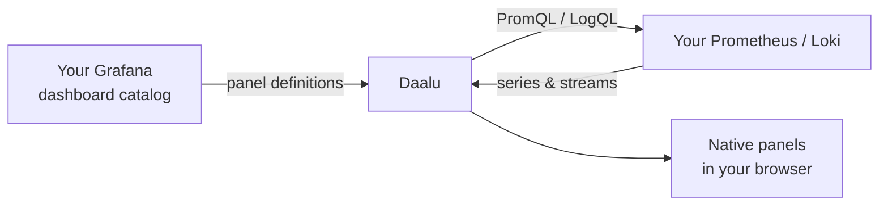

# 48. Dashboards — your Grafana boards, rendered natively

**Dashboards** in the sidebar, under *Insights*
(`https://ops.example.com/dashboards`), shows
your Grafana dashboards **inside Daalu** — no iframe, no Grafana detour.
Grafana stays the *catalog* (the list of boards and each board's panel
definitions); Daalu renders the panels itself by running their PromQL and
LogQL against **your own** Prometheus and Loki. You can also have the AI
write a brand-new dashboard from a one-line prompt.

---

## How it works

- **Grafana is the store.** Daalu reads the list of dashboards and each
  board's panel JSON through your Grafana integration. Boards you create
  in Grafana appear here; boards Daalu's AI creates land back *in
  Grafana*, so both tools always show the same list.
- **Your data plane fills the panels.** Panel queries run against the
  metric and log stores co-located with that Grafana — through your
  cluster tunnel when the stack lives in your own cluster. Your series
  never pass through a third party.
- **Template variables just work.** Grafana boards full of `$namespace`,
  `$cluster`, `$__rate_interval` render correctly — Daalu expands the
  variables and macros before querying, so the standard Kubernetes mixin
  boards light up without editing.

---

## Prerequisite: the Grafana integration

The page needs a connected **Grafana** integration (URL + API token) so
Daalu can read your catalog. If it isn't connected yet, the page shows a
**Grafana not connected** banner pointing you at **Managed infra →
Clusters & observability**, where Grafana is a row under
*Observability*. Chapter 31 covers the setup; if your Grafana is inside a
connected cluster, tick the tunnel option and use its in-cluster URL as
usual.

---

## Browsing and reading a board

The page lists every dashboard, grouped by Grafana folder, with its tags.
Click one to open it:

- Panels render natively — time series, stats, tables, and log panels.
- A **time-range switcher** re-runs every panel over the window you pick.
- Each panel queries live — what you see is your store's answer right
  now, not a cached screenshot.

---

## Create with AI

The **Create with AI** button opens a dialog, *Create a dashboard with
AI*:

1. **What to show** — describe the board in plain language, e.g.
   `Cluster-wide CPU and memory by namespace, plus pod restart counts`.
   Example prompts are one click away.
2. **Title** (optional — named from your description if blank) and
   **Data** — Metrics (Prometheus), Logs (Loki), or Mixed.
3. Click **Generate dashboard** (it stays disabled until you've
   described what to show). Daalu's AI writes a complete Grafana dashboard
   (PromQL/LogQL panels, layout, units), **saves it into your Grafana**,
   and opens it here.

Because the AI writes a real Grafana dashboard rather than something
proprietary, you can refine it later in Grafana itself — or ask the AI
for another one.

---

## Where dashboards show up elsewhere

- The **cluster detail page** (chapter 17) shows the related
  dashboards on its **Dashboards** tab.
- The **Managed infra** observability rows link into the same boards.
- For GPU fleets, the **AI Factory** page (chapter 50) has its own native
  GPU panels built on the same data plane.

---

## See also

- Chapter 31 — connecting Grafana, Prometheus, Loki, and friends.
- Chapter 17 — the cluster health overview and metric/log consoles.
